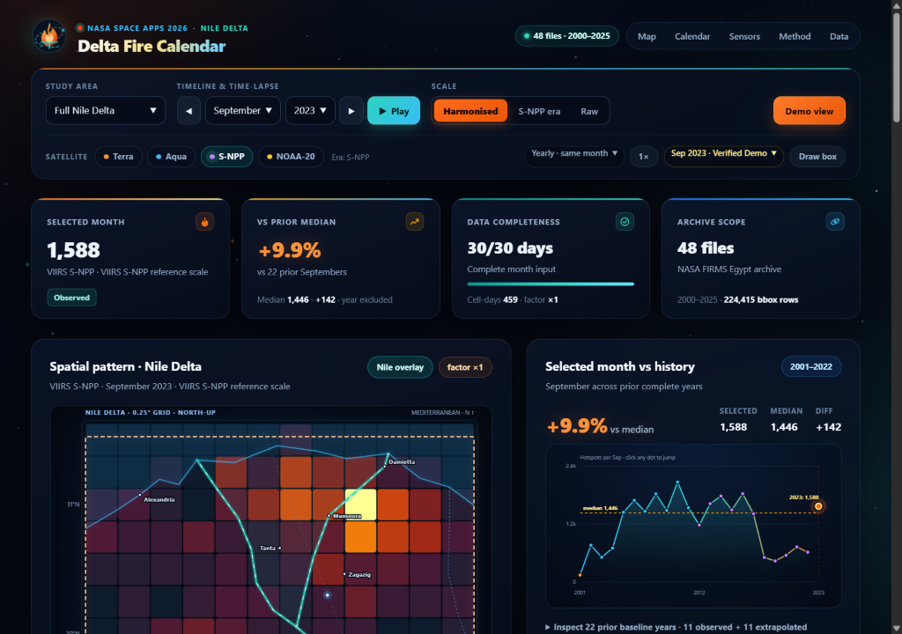
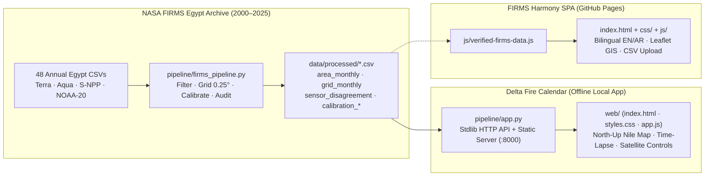
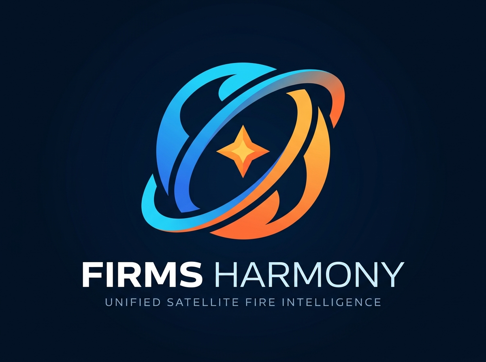
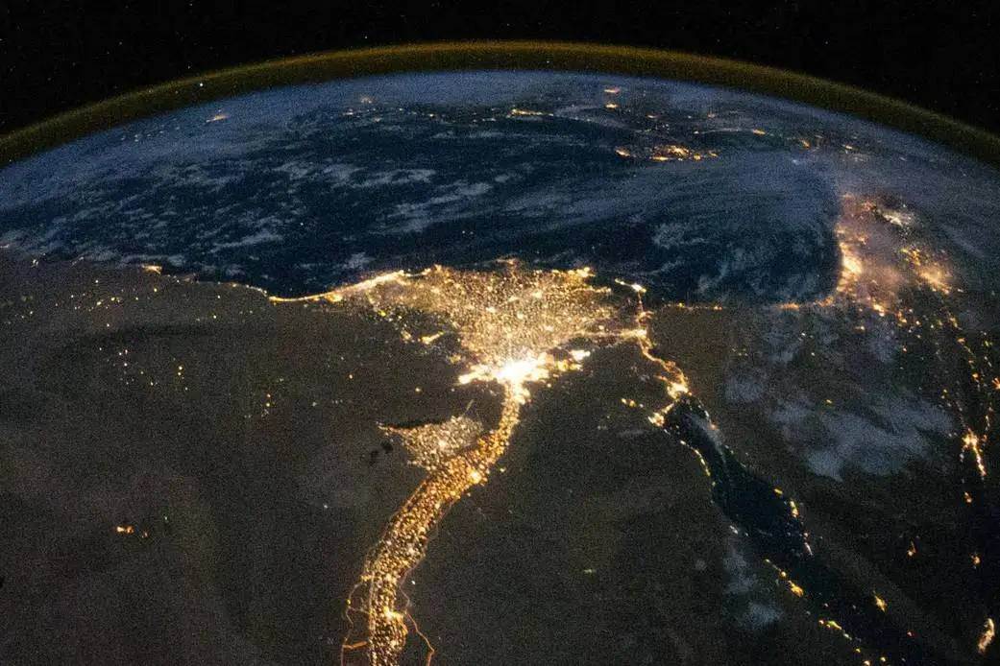

<div align="center">



<br><br>

[](https://mayarmajed2.github.io/FIRMS-Harmony/web/)
[](https://mayarmajed2.github.io/FIRMS-Harmony/)
[](https://www.spaceappschallenge.org/2026/challenges/modis-and-viirs-hot-spots/)
[-f59e0b?style=for-the-badge)](data/processed/coverage_summary.csv)
[](data/processed/calibration_baseline.csv)
[](#quick-start)

<h3>
  <em>Turning 25 years of fragmented NASA MODIS &amp; VIIRS detections into one honest, comparable Nile Delta fire calendar.</em>
</h3>

<p>
  <a href="https://mayarmajed2.github.io/FIRMS-Harmony/web/"><strong>🚀 Open Live Delta Calendar</strong></a> &nbsp;·&nbsp;
  <a href="https://mayarmajed2.github.io/FIRMS-Harmony/"><strong>🌍 Open Live EN/AR SPA</strong></a> &nbsp;·&nbsp;
  <a href="#quick-start"><strong>⚡ 60s Local Run</strong></a> &nbsp;·&nbsp;
  <a href="#-interactive-explorers"><strong>🛰️ Interactive Explorers</strong></a> &nbsp;·&nbsp;
  <a href="#-documentation"><strong>📚 Docs</strong></a>
</p>

</div>

---

<table>
  <tr>
    <td align="center" width="25%">
      <h3>🛰️ 4 Satellites</h3>
      <sub><strong>Terra · Aqua · S-NPP · NOAA-20</strong><br>Bridging 1 km MODIS &amp; 375 m VIIRS</sub>
    </td>
    <td align="center" width="25%">
      <h3>📅 25+ Years</h3>
      <sub><strong>2000-11 → 2025-12</strong><br>48 verified Egypt FIRMS archives</sub>
    </td>
    <td align="center" width="25%">
      <h3>📉 −54.5% MAE</h3>
      <sub><strong>Out-of-sample (2023–2025)</strong><br>Validated against VIIRS S-NPP</sub>
    </td>
    <td align="center" width="25%">
      <h3>⚡ 0 Dependencies</h3>
      <sub><strong>Python stdlib + Vanilla JS</strong><br>Offline-ready at demo time</sub>
    </td>
  </tr>
</table>

> [!IMPORTANT]
> **Scientific Honesty First:** A satellite **hotspot detection is not a confirmed fire incident**. This project reports thermal detections, input completeness, out-of-sample rescaling accuracy, and explicit caveats—never invented data for missing months (`2026` is explicitly marked **Missing**) and never unvalidated scaling on custom boxes.

---

## ✨ Live Mission Dashboard

<div align="center">
  
  <br>
  <sub><strong>Delta Fire Calendar (<code>pipeline/app.py</code> + <code>web/</code>):</strong> True North-Up 0.25° Nile Delta grid with animated Rosetta &amp; Damietta river branches, gliding polar-orbit satellite sweep, one-click <code>Terra / Aqua / S-NPP / NOAA-20</code> isolation, Time-Lapse player, and prior-year anomaly baseline.</sub>
</div>

### What Makes It Shine

| Experience | What You Can Do |
| :--- | :--- |
| **🗺️ North-Up Nile Delta Spatial Grid** | Explore `96` (`0.25°`) grid cells over `29.50–32.50°E, 29.80–31.65°N` with toggleable **Nile River & Mediterranean Coast overlay**, animated polar satellite ground-track, hover telemetry tooltips, and **drag-to-draw custom rectangles** (raw counts enforced). |
| **🛰️ One-Click Satellite Isolation** | Click **`Terra`**, **`Aqua`**, **`S-NPP`**, or **`NOAA-20`** right in the command bar to isolate any instrument—or click **`Harmonised`** to view the continuous multi-era S-NPP-equivalent series. |
| **🎬 Interactive Time-Lapse Player** | Press **`▶ Play`** (or `Space`) to animate the Nile Delta **year-by-year** for the same calendar month (`2001 → 2025`) or **month-by-month** at `1×` / `2×` speed, with `←` / `→` keyboard stepping. |
| **⚖️ Aqua vs. S-NPP Sensor Disagreement** | Inspect per-cell UTC calendar-day pairing (`Aqua only`, `S-NPP only`, `Both`), animated breakdown bars, unsigned disagreement share (`88.4%` in Sep 2023), one-click cross-check query copy, and CSV export. |
| **🌍 Dual-Mode Bilingual SPA (`index.html`)** | Open `index.html` directly (or deploy on GitHub Pages) for the **English / Arabic RTL** Leaflet GIS map, client-side NASA FIRMS CSV uploader, Haversine cross-sensor matcher, and FRP physics explorer. |

---

<a id="quick-start"></a>
## ⚡ 60-Second Quick Start

```bash
git clone https://github.com/mayarmajed2/FIRMS-Harmony.git
cd FIRMS-Harmony
```

Choose how you want to run it—**both work with zero `npm install` and zero pip packages:**

<table>
  <thead>
    <tr>
      <th align="left">Mode</th>
      <th align="left">Command</th>
      <th align="left">Best For</th>
    </tr>
  </thead>
  <tbody>
    <tr>
      <td><strong>🔥 Delta Fire Calendar</strong><br><sub>Full 2000–2025 Local Archive Server</sub></td>
      <td><code>python pipeline/app.py</code><br>Open <a href="http://127.0.0.1:8000"><code>http://127.0.0.1:8000</code></a></td>
      <td>Full 48-file Nile Delta calendar, <code>Terra/Aqua/S-NPP/NOAA-20</code> buttons, North-Up Nile map, disagreement grid, validation audit &amp; CSV exports. <strong>100% offline.</strong></td>
    </tr>
    <tr>
      <td><strong>🌍 FIRMS Harmony SPA</strong><br><sub>Static Bilingual EN/AR Web App</sub></td>
      <td><code>python -m http.server 8080</code><br>Open <code>http://localhost:8080</code></td>
      <td>GitHub Pages static hosting, Leaflet Nile corridor GIS map, live browser NASA FIRMS CSV upload &amp; Arabic RTL mode.</td>
    </tr>
  </tbody>
</table>

> [!TIP]
> **Direct Demo Deep Link** (once `python pipeline/app.py` is running):
> ```text
> http://127.0.0.1:8000/?area=full&year=2023&month=9&scale=harmonized&platform=snpp
> ```
> **Keyboard Shortcuts inside Delta Fire Calendar:** `←` / `→` step time · `Space` play/pause time-lapse · `R` reset to Sep 2023 Demo view.

---

## 🔥 Why FIRMS Harmony?

Over **95% of Egypt's population** lives along the fertile Nile Valley and Delta, where seasonal post-harvest crop-residue burning (especially autumn rice-straw burning in **Dakahlia, Sharqia, Gharbia, and Kafr El-Sheikh**) drives major air-quality episodes.

Tracking multi-decade burning trends requires bridging **MODIS (2000–present, 1 km pixel)** and **VIIRS (2012–present, 375 m pixel)**. Simply merging raw hotspot counts creates a massive **2012 sensor artifact**: VIIRS detects **~18–19× more hotspots** per month over the Nile Delta than MODIS because small agricultural fires fall below MODIS's 1 km thermal threshold.

**FIRMS Harmony** solves this transparently—fitting out-of-sample multiplicative rescaling factors (`2013–2022` train, `2023–2025` held-out test), exposing where calibration succeeds vs. fails (`NOAA-20`), separating true zeros from missing archives (`2026`), and visualizing exact cell-day sensor disagreement.

---

## 🛰️ Interactive Explorers

Click any section below to expand live verified metrics, judge scenarios, system architecture, and reproduction checks:

<details open>
<summary><strong>🛰️ Satellite Constellation &amp; Out-of-Sample Calibration Results (2013–2022 Train · 2023–2025 Test)</strong></summary>

<br>

| Platform | Resolution | Verified Archive | Complete Months | Calibration Factor | Held-Out MAE (Raw → Calibrated) | Held-Out Bias | Verdict |
| :--- | :---: | :---: | :---: | :---: | :---: | :---: | :---: |
| **MODIS Terra** | `1 km` | `2000-11 → 2025-12` | `302` | **`×18.389`** | `309.75` → **`141.17`** (`−54.4%`) | `−309.75` → `−17.51` | ✅ **MAE Improved** |
| **MODIS Aqua** | `1 km` | `2002-07 → 2025-12` | `282` | **`×19.226`** | `308.67` → **`140.32`** (`−54.5%`) | `−308.67` → `+17.38` | ✅ **MAE Improved** |
| **VIIRS S-NPP** | `375 m` | `2012-02 → 2025-12` | `167` | **`×1.000`** *(Ref)* | *Reference Scale* | `0.00` | 🎯 **Reference** |
| **VIIRS NOAA-20** | `375 m` | `2018-04 → 2025-12` | `93` | `×1.015` *(Rejected)* | `28.86` → **`30.43`** (`+5.4%`) | `+14.03` → `+18.99` | ⚠️ **Kept Raw** |

<sub>All metrics are generated deterministically by <code>pipeline/firms_pipeline.py</code> from <code>224,415</code> Delta bounding-box rows (<code>109,893</code> eligible <code>type=0</code> Standard Processing rows).</sub>

</details>

<details>
<summary><strong>🔥 5 Judge-Ready Verified Demo Scenarios (Built into the UI Dropdown)</strong></summary>

<br>

| Scenario | Parameters | Verified Headline | Why Judges Love It |
| :--- | :--- | :--- | :--- |
| **1. Sep 2023 Demo** | `Full Delta · 2023-09 · Harmonised` | **`1,588`** (`+9.9%` vs median `1,446`, `30/30` days) | Complete observed month; map cell sum (`1,588`) matches raw CSV row count identically; peak disagreement cell `30.88°N, 31.63°E` = `1 / 19 / 9 / 29`. |
| **2. Oct 2023 Contrast** | `Full Delta · 2023-10 · Harmonised` | **`1,684`** (`−21.8%` vs median `2,154`) | Proves the calendar surfaces below-median autumn months honestly—no cherry-picking. |
| **3. West Delta Sign Flip** | `Western Delta · 2023-09 · Harmonised` | **`226`** (`+33.6%` full vs **`−14.7%`** S-NPP-only median `265`) | Automatically detects when mixed extrapolated MODIS + observed S-NPP years flip the anomaly sign and plots **both** dashed medians! |
| **4. NOAA-20 Guardrail** | `Full Delta · 2023-09 · Raw · NOAA-20` | **`1,536`** (`+151.0%` vs median `612`) | Displays explicit **`Raw only`** + **`Calibration failed`** badges because NOAA-20 worsened held-out MAE (`+5.4%`). |
| **5. 2026 Missing Input** | `Full Delta · 2026-09 · Harmonised` | **`Missing`** (`0%` completeness · Map overlay) | Never invents a fake zero when local archive input is absent. |

</details>

<details>
<summary><strong>🏗️ Dual-App System Architecture (Mermaid Diagram)</strong></summary>

<br>



</details>

<details>
<summary><strong>🧪 10-Second Scientific Reproduction &amp; Verification Commands</strong></summary>

<br>

Verify every headline number straight from the committed `data/processed/` files:

```powershell
# 1. Verify September 2023 Full Delta headline count (expected: ['1588.0'])
python -c "import csv; r=list(csv.DictReader(open('data/processed/area_monthly.csv',encoding='utf-8-sig'))); print([x['harmonized_hotspots'] for x in r if x['area_id']=='full' and x['month']=='2023-09' and x['platform']=='snpp'])"

# 2. Verify peak disagreement cell 30.88°N, 31.63°E (expected: aqua_only=1, snpp_only=19, both=9 -> total 29)
python -c "import csv; r=[x for x in csv.DictReader(open('data/processed/sensor_disagreement.csv',encoding='utf-8-sig')) if x['month']=='2023-09' and float(x['west'])==31.5 and float(x['south'])==30.75]; print([(x['observed_in'], x['cell_days']) for x in r])"

# 3. Verify 2026 is explicitly marked missing (never a fake zero)
python -c "import csv; r=list(csv.DictReader(open('data/processed/area_monthly.csv',encoding='utf-8-sig'))); print([(x['estimate_status'],x['input_status']) for x in r if x['area_id']=='full' and x['month']=='2026-09' and x['platform']=='snpp'])"
```

</details>

<details>
<summary><strong>📁 Clean Repository Structure</strong></summary>

<br>

```text
FIRMS-Harmony/
├── README.md                          # Interactive mission overview & quick start
├── CHANGELOG.md                       # Version history
├── CONTRIBUTING.md                    # Contributor workflow & standards
├── .gitignore                         # Clean ignore rules (caches, zips, raw archives)
│
├── pipeline/                          # 🔥 Delta Fire Calendar Python Backend & ETL
│   ├── app.py                         # Zero-dependency HTTP API & static server (port 8000)
│   └── firms_pipeline.py              # Reproducible FIRMS parser, gridder & calibration audit
├── web/                               # ✨ Delta Fire Calendar NASA × Fire × Nile Frontend
│   ├── index.html                     # Mission UI shell & animated orbital SVG emblem
│   ├── styles.css                     # NASA space × thermal fire × Nile emerald design system
│   └── app.js                         # North-Up Nile map, satellite toggles, time-lapse & charts
├── data/processed/                    # 📊 Verified 2000–2025 Processed Outputs (16 canonical files)
│
├── index.html                         # 🌍 Static Bilingual (EN/AR) FIRMS Harmony SPA
├── css/styles.css                     # SPA aerospace theme, responsive & RTL layout
├── js/                                # Modular ES6 SPA engines (Leaflet map, CSV parser, i18n, motion)
├── assets/                            # Brand logos, animated SVG banner, preview & Nile backdrop
├── docs/                              # Architecture, installation, user guide, data schemas & FAQ
└── tests/index.html                   # Browser-runnable unit & adversarial test suite
```

</details>

<details>
<summary><strong>📐 Calibration &amp; Radiometric Formulation</strong></summary>

<br>

- **Cross-Sensor Count Rescaling (Delta Fire Calendar):** For each MODIS instrument $s \in \{\text{Terra}, \text{Aqua}\}$, a scalar multiplicative factor $k_s$ is fitted exclusively on training overlap months (`2013–2022`) to align monthly hotspot totals to the VIIRS S-NPP reference scale, then evaluated out-of-sample on `2023–2025` via Mean Absolute Error (MAE) and mean bias. If held-out MAE worsens (as for `NOAA-20`), raw counts are retained explicitly.
- **Fire Radiative Power (Wooster et al., 2003):**

$$\text{FRP} = \frac{A_{\text{pix}} \cdot \sigma}{a} \left(T_4^4 - T_{4,\text{bg}}^4\right)$$

- **Empirical Overlap Ratios (Static SPA):** $R_{\text{count}} = N_{\text{VIIRS}} / N_{\text{MODIS}}$, $R_{\text{FRP}} = \sum \text{FRP}_{\text{VIIRS}} / \sum \text{FRP}_{\text{MODIS}}$, and $\alpha = \overline{\text{FRP}}_{\text{VIIRS}} / \overline{\text{FRP}}_{\text{MODIS}}$.

</details>

<details>
<summary><strong>⚠️ Scientific Caveats &amp; Limitations Disclosure</strong></summary>

<br>

- **Detections ≠ Confirmed Incidents:** FIRMS active-fire pixels measure mid-infrared thermal anomalies, not verified agricultural burn permits, crop types, or burned-area extent.
- **MODIS Product Version Shifts (`6.2 → 6.03 → 61.03`):** Collection segment factors shift across archive versions, so pre-2013 calibrated values are explicitly flagged **Extrapolated**.
- **Detection Disagreement ≠ Sensor Blind Spot:** Without fire-mask products (`MYD14` / `VNP14IMG`), the denominator only includes active cell-days (`aqua_only + snpp_only + both`).
- **Custom Rectangles Stay Raw:** Local factors vary substantially across the Delta (`15.38` Aqua North to `32.66` Aqua South), so custom drawn boxes always enforce raw counts.
- **Historical Tool Only:** No fire forecasting or live API polling is performed at demo time; `2026` awaits a local FIRMS archive or `MAP_KEY`.

</details>

<details>
<summary><strong>🖼️ Brand Identity &amp; Visual Assets</strong></summary>

<br>

| Asset | Preview | Usage |
| :---: | :---: | :--- |
| **Animated Banner** | [`assets/banner.svg`](assets/banner.svg) | Animated NASA × Fire × Nile Delta SVG hero banner with polar satellite sweep & flowing river currents |
| **Primary Lockup** |  | High-resolution FIRMS Harmony orbital emblem & wordmark ([`assets/firms-harmony-logo.png`](assets/firms-harmony-logo.png)) |
| **App Icon** |  | Favicon & SPA header icon ([`assets/firms-harmony-icon.png`](assets/firms-harmony-icon.png)) |
| **Nile Night Backdrop** |  | NASA Earth Observatory ISS nighttime Nile corridor photography ([`assets/nile-night.jpg`](assets/nile-night.jpg)) |

</details>

---

## 📚 Documentation

| Guide | What's Inside |
| :--- | :--- |
| [FIRMS_Harmony_Project_Overview.pdf](docs/FIRMS_Harmony_Project_Overview.pdf) | **8-page executive & technical PDF report** (problem, pipeline, validation, features & results) |
| [ARCHITECTURE.md](docs/ARCHITECTURE.md) | Event bus, module lifecycles, spatial engine & rendering pipeline |
| [INSTALLATION.md](docs/INSTALLATION.md) | Local server setup, browser requirements & verification checklist |
| [USER_GUIDE.md](docs/USER_GUIDE.md) | Step-by-step feature walkthrough, CSV uploads & Arabic RTL mode |
| [DATA_DOCUMENTATION.md](docs/DATA_DOCUMENTATION.md) | Processed CSV schemas, Nile corridor polygon & FIRMS parsing rules |
| [DEVELOPMENT.md](docs/DEVELOPMENT.md) | Coding standards, zero-build philosophy & testing workflow |
| [DEPLOYMENT.md](docs/DEPLOYMENT.md) | Hosting on GitHub Pages, Netlify, Cloudflare Pages & Vercel |
| [FAQ.md](docs/FAQ.md) | Troubleshooting & common scientific questions |

---

## 🛰️ Data & Literature Credits

- **NASA FIRMS Active Fire Data:** [firms.modaps.eosdis.nasa.gov](https://firms.modaps.eosdis.nasa.gov/) (`doi:10.5067/FIRMS/data`) — MODIS Collection 6.x (`MOD14`/`MYD14`) & VIIRS Collection 2 (`VNP14IMG`/`VJ114IMG`).
- **Challenge:** [NASA Space Apps 2026 — Harmonization of MODIS and VIIRS Hot Spots](https://www.spaceappschallenge.org/2026/challenges/modis-and-viirs-hot-spots/).
- **References:** Wooster et al. (2003), *Remote Sensing of Environment*; Schroeder et al. (2014), *RSE*; Giglio et al. (2016), *RSE*; El-Metwally et al. (2019); Ramadan et al. (2021).

---

<div align="center">
  <sub>Built with 🛰️ NASA Earth Observation data, 🔥 thermal transparency, and 🌊 love for the Nile Delta · <a href="CHANGELOG.md">Changelog</a> · <a href="CONTRIBUTING.md">Contributing</a></sub>
</div>
