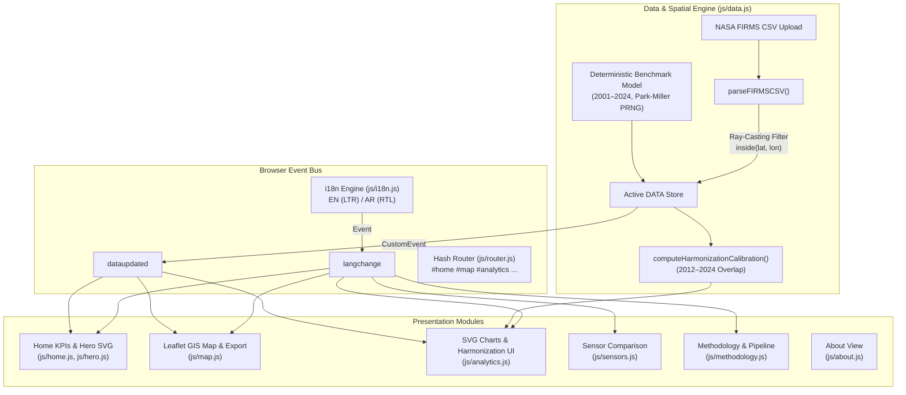

<div align="center">
  

  <br><br>

  [](https://developer.mozilla.org/en-US/docs/Web/HTML)
  [](https://developer.mozilla.org/en-US/docs/Web/CSS)
  [](https://developer.mozilla.org/en-US/docs/Web/JavaScript)
  [](https://leafletjs.com/)
  [](docs/USER_GUIDE.md#language-and-rtl-support)
  [](tests/index.html)
  [-f08a3c?style=for-the-badge)](data/processed/coverage_summary.csv)
  [](docs/INSTALLATION.md)

  <p>
    <em>Separating true agricultural burning trends from satellite sensor resolution artifacts across 24 years of Nile Valley and Delta observations.</em>
  </p>

  <p>
    <a href="#-project-overview"><strong>Overview</strong></a> &nbsp;•&nbsp;
    <a href="#-key-features"><strong>Features</strong></a> &nbsp;•&nbsp;
    <a href="#-system-architecture"><strong>Architecture</strong></a> &nbsp;•&nbsp;
    <a href="#-installation--setup-guide"><strong>Quick Start</strong></a> &nbsp;•&nbsp;
    <a href="#-usage-instructions"><strong>Usage</strong></a> &nbsp;•&nbsp;
    <a href="#-documentation"><strong>Docs</strong></a> &nbsp;•&nbsp;
    <a href="tests/index.html"><strong>Test Suite</strong></a>
  </p>
</div>

---

## 🌍 Project Overview

**Fire Harmony** is a lightweight, client-side geospatial web application designed to visualize, analyze, and harmonize thermal active-fire detections along Egypt's **Nile Valley and Delta** corridor (Aswan at `24.0°N` to the Mediterranean coast at `31.6°N`).

The platform brings together two generations of NASA thermal-infrared Earth observation instruments—**MODIS** (1 km nadir resolution, active since 2000) and **VIIRS** (375 m I-band nadir resolution, active since 2012)—in an interactive single-page application. Rather than merging raw fire counts across instruments, Fire Harmony explicitly separates MODIS and VIIRS observations, quantifies cross-sensor overlap ratios, filters detections to the fertile Nile corridor polygon, and allows analysts to upload their own standard **NASA FIRMS CSV** exports directly in the browser.

---

## 🔥 The Problem It Solves

Long-term wildfire and agricultural burning studies routinely span more than two decades, bridging the **MODIS era (2000–present)** and the **VIIRS era (2012–present)**. However, naively concatenating or summing raw detection counts across both sensors produces a severe **2012 sensor transition artifact**:

- **Resolution Disparity:** One MODIS `1 km` pixel covers roughly the same ground footprint as **~7 VIIRS `375 m` pixels**.
- **Sub-Pixel Thermal Dilution:** Small, brief agricultural residue burns (such as rice-straw fires in the Nile Delta) frequently fall below MODIS's thermal detection threshold, while VIIRS resolves them clearly—producing **~3–5× more detections** over the exact same landscape without any real increase in burning.
- **Background Contamination:** Unclipped regional fire archives for Egypt include desert oil/gas flares and industrial thermal anomalies outside the cultivated Nile corridor.

**Fire Harmony** addresses these challenges by keeping sensor streams strictly disaggregated, computing empirical overlap calibration ratios (`2012–2024`), enforcing a calibrated Nile corridor boundary polygon, and presenting Fire Radiative Power (FRP) alongside detection counts.

---

## ✨ Key Features

- **🗺️ Interactive Nile Corridor GIS Map (`#map`)**
  - Dark-themed Leaflet 1.9.4 map constrained to the Nile Valley and Delta boundary (`BOUNDARY` polygon + `NILE_LINE` and `DELTA_LINES` overlays).
  - Real-time filtering by sensor (`MODIS`, `VIIRS`), year window (`2001–2024`), and minimum Fire Radiative Power (`0–60 MW`).
  - Distinct visual encoding: squares (`■`) for MODIS, circles (`●`) for VIIRS, shaded along a 6-step thermal FRP color ramp.
  - Yearly time-lapse playback (`1.3 s/year`, automatically respecting `prefers-reduced-motion`).
  - Clickable marker inspection with nearby-detection density count (within `~0.1° ≈ 11 km`) and one-click filtered CSV export.

- **📊 Native SVG Analytics & Harmonization Dashboard (`#analytics`)**
  - Six live KPI cards: Total Detections, Mean FRP, Median FRP, Peak Month, Years of Record, and Harmonized MODIS Linear Trend (ordinary least squares slope in detections/year).
  - Three zero-dependency inline SVG visualizations: **Yearly Stacked Activity** (with explicit 2012 transition marker), **Monthly Seasonality** (highlighting the Oct–Dec rice-straw peak), and **FRP Distribution Histogram** (with median reference line).
  - **Nile Delta Agricultural Burning Calendar** aligning fire cycles with Egyptian crop phenology (autumn rice straw, spring wheat stubble, summer growing minimum).
  - **Empirical Cross-Sensor Harmonization Matrix** computing overlap count ratio ($R_{\text{count}}$), MODIS/VIIRS mean FRP, and mean intensity ratio ($\alpha$) across `2012–2024`.
  - **Spatiotemporal Correspondence & Confidence Normalization Engine:** Non-destructively classifies detections into **Corroborated Agreement** (`MODIS ↔ VIIRS` within `≤ 1.5 km` Haversine distance and `≤ 6 h` UTC overpass tolerance), **VIIRS-Only** (sub-pixel), and **MODIS-Only** (overpass/cloud disagreement), flags same-sensor near-duplicates (`< 0.5 km`), and normalizes MODIS numeric confidence (`0–100%`) alongside VIIRS categorical confidence (`l`/`n`/`h`).

- **📂 Client-Side NASA FIRMS CSV Ingestion**
  - Upload standard NASA FIRMS CSV exports (`MOD14`/`MYD14` MODIS or `VNP14IMGTDL`/`VJ114IMGTDL` VIIRS) directly from the Analytics view.
  - Automatic ray-casting point-in-polygon clipping against the Nile corridor boundary with live feedback on loaded and excluded detections.
  - Instant cross-view synchronization via a custom `dataupdated` browser event bus, with one-click reset to the calibrated benchmark dataset.

- **🛰️ Sensor Physics & Scientific Methodology Views (`#sensors`, `#methodology`)**
  - Side-by-side MODIS vs. VIIRS instrument specifications, overlap bar chart, and sub-pixel resolution geometry diagram.
  - Six-stage SVG data processing pipeline, FRP radiometric formulation (Wooster et al., 2003), peer-reviewed citations, and explicit scientific limitations disclosure.

- **🛰️ Integrated Real NASA FIRMS Egypt Archive & Python Pipeline (2000–2025)**
  - Includes real, out-of-sample validated processed outputs from **74 official NASA FIRMS annual archive files** (`Terra`, `Aqua`, `VIIRS S-NPP`, `VIIRS NOAA-20`, spanning `2000-11` to `2025-12`) under [`data/processed/`](data/processed/).
  - Reproducible Python ETL & validation pipeline in [`pipeline/firms_pipeline.py`](pipeline/firms_pipeline.py) and [`pipeline/app.py`](pipeline/app.py).
  - Rendered live inside `#analytics` via [`js/verified-firms-data.js`](js/verified-firms-data.js): continuous `2001–2025` raw vs. harmonized VIIRS-equivalent SVG series and 36-month held-out MAE/bias validation (`Terra` MAE `-54.4%`, `Aqua` MAE `-54.5%`).

- **🌐 Bilingual Interface (English LTR & Arabic RTL)**
  - Instant switching between English (`en`, `dir="ltr"`) and Arabic (`ar`, `dir="rtl"`) with `localStorage` persistence (`fh-lang`), Cairo Arabic typography, and mirrored RTL layout controls.

---

## 🌱 Why This Project Matters

Over **95% of Egypt's population** (90+ million people) and nearly all of its irrigated farmland are concentrated along a narrow `~35,000 km²` fertile ribbon stretching from Aswan to the Mediterranean Sea. Seasonal post-harvest crop residue burning—especially autumn rice-straw combustion across Dakahlia, Sharqia, Gharbia, and Kafr El-Sheikh—is a well-documented contributor to regional smoke and air-quality episodes.

Evaluating whether agricultural burning policies are succeeding requires **consistent multi-decadal baselines**. Fire Harmony provides an accessible, transparent tool for researchers, students, environmental analysts, and citizens to inspect active-fire trends without being misled by satellite instrument transitions.

---

## 🏗️ System Architecture

Fire Harmony uses an **event-driven, client-side Single-Page Application (SPA)** architecture with zero build step and zero backend server requirements.



For a deeper technical breakdown of script loading order, DOM lifecycles, and event flows, see [docs/ARCHITECTURE.md](docs/ARCHITECTURE.md).

---

## 🛠️ Technology Stack

| Layer | Technology | Role in Fire Harmony |
| :--- | :--- | :--- |
| **Markup & Layout** | HTML5, CSS3 Custom Properties, Grid & Flexbox | Semantic SPA shell, dark thermal theme, responsive breakpoints, RTL support |
| **Application Logic** | Vanilla JavaScript (ES6+) | Spatial ray-casting, CSV parser, statistics, routing, and DOM rendering |
| **Interactive Mapping** | [Leaflet 1.9.4](https://leafletjs.com/) (via cdnjs) | Interactive slippy map, polygon/polyline overlays, custom `divIcon` markers |
| **Map Basemap** | [CARTO Dark Matter](https://carto.com/attributions) / OpenStreetMap | Dark raster tile basemap for high-contrast thermal marker legibility |
| **Data Visualization** | Native Inline SVG | Stacked yearly bars, grouped monthly bars, FRP histogram, overlap & pixel diagrams |
| **Typography** | Google Fonts (`Fraunces`, `DM Sans`, `Cairo`) | Editorial display headings, UI copy, and full Arabic script rendering |
| **State & Persistence** | Browser DOM Events & `localStorage` | Reactive cross-module updates (`dataupdated`, `langchange`) and language preference |

---

## ⚙️ How It Works

### 1. Spatial Boundary Clipping (`js/data.js`)
Every detection coordinate `(lat, lon)`—whether procedurally generated for the benchmark model or parsed from an uploaded NASA FIRMS CSV—is tested against a 25-vertex polygon (`BOUNDARY`) enclosing the fertile Nile Valley and Delta (`24.0°N–31.6°N`, `30.2°E–33.1°E`) using a **ray-casting point-in-polygon algorithm** (`inside(lat, lon)`). Points outside this corridor are excluded.

### 2. Cross-Sensor Harmonization (`computeHarmonizationCalibration`)
Over the co-observation baseline (`2012–2024`), Fire Harmony computes three empirical metrics to quantify sensor divergence:

- **Count Inflation Ratio:** $R_{\text{count}} = \dfrac{N_{\text{VIIRS}}}{N_{\text{MODIS}}}$
- **Total Radiative Energy Ratio:** $R_{\text{FRP}} = \dfrac{\sum \text{FRP}_{\text{VIIRS}}}{\sum \text{FRP}_{\text{MODIS}}}$
- **Mean Intensity Ratio:** $\alpha = \dfrac{\overline{\text{FRP}}_{\text{VIIRS}}}{\overline{\text{FRP}}_{\text{MODIS}}}$

Long-term linear trend estimation on the Analytics dashboard uses **MODIS-only** annual counts (`2001–2024`) via ordinary least squares regression so that the 2012 VIIRS introduction does not bias the multi-decadal slope.

### 3. Radiometric Formulation
Fire Radiative Power (MW) follows the mid-infrared (MIR ~4 µm) formulation of Wooster et al. (2003):

$$\text{FRP} = \frac{A_{\text{pix}} \cdot \sigma}{a} \left(T_4^4 - T_{4,\text{bg}}^4\right)$$

On the interactive map, FRP values are mapped onto a 6-step thermal ramp (`#3b1d7a` → `#fff3c4`) using a square-root perceptual scale (`Math.sqrt(frp / 60)`).

---

## 📁 Project Structure

```text
FIRMS-Harmony/
├── index.html                  # Single-page application shell & script manifest
├── README.md                   # Project overview & quick start
├── CHANGELOG.md                # Version history
├── CONTRIBUTING.md             # Contributor workflow & standards
├── .gitignore                  # Git ignore rules
├── assets/
│   ├── banner.svg              # Wide vector hero banner for repository presentation
│   ├── logo.svg                # Vector brand emblem & SVG favicon
│   └── nile-night.jpg          # NASA Earth Observatory nighttime Nile backdrop
├── css/
│   └── styles.css              # Design tokens, layout, responsive & RTL styles
├── data/
│   └── processed/              # Real NASA FIRMS Egypt (2000–2025) validated CSV outputs
├── pipeline/
│   ├── firms_pipeline.py       # Python ETL, spatial clipping & out-of-sample calibration pipeline
│   └── app.py                  # Dependency-free Python API & server for Delta Fire Calendar (port 8000)
├── web/                        # Delta Fire Calendar interactive NASA × Fire × Nile Delta UI
│   ├── index.html              # Mission dashboard shell & animated orbital emblem
│   ├── styles.css              # NASA deep space × thermal fire × Nile emerald responsive design
│   └── app.js                  # North-up Nile Delta map, Terra/Aqua/S-NPP/NOAA-20 controls, time-lapse & audit
├── js/
│   ├── utils.js                # Shared DOM, HTML-escaping & CSV-sanitization helpers
│   ├── i18n.js                 # EN/AR dictionary, RTL switcher & langchange event
│   ├── data.js                 # Nile polygon, benchmark generator, FIRMS CSV parser & calibration
│   ├── verified-firms-data.js  # Real 2000–2025 NASA FIRMS harmonized archive data for SPA
│   ├── hero.js                 # Animated abstract Nile SVG illustration
│   ├── home.js                 # Dynamic Home KPI counters
│   ├── map.js                  # Leaflet GIS map, filters, time-lapse & CSV export
│   ├── analytics.js            # SVG charts, burning calendar, harmonization matrix & CSV uploader
│   ├── sensors.js              # MODIS vs. VIIRS comparison & sub-pixel physics diagrams
│   ├── methodology.js          # Data pipeline SVG, equations, citations & limitations
│   ├── about.js                # Mission, objectives, study area & data source links
│   └── router.js               # Hash-based SPA routing (#home, #map, #analytics, ...)
└── docs/
    ├── ARCHITECTURE.md         # System architecture, modules & event bus
    ├── INSTALLATION.md         # Setup, local servers & verification
    ├── USER_GUIDE.md           # Complete feature walkthrough
    ├── DATA_DOCUMENTATION.md   # Schemas, synthetic model & FIRMS CSV format
    ├── DEVELOPMENT.md          # Development workflow & coding standards
    ├── DEPLOYMENT.md           # Static hosting & production deployment
    └── FAQ.md                  # Troubleshooting & common questions
└── tests/
    └── index.html              # Browser-runnable unit & adversarial test suite
```

---

## 🚀 Installation & Setup Guide

Fire Harmony requires **no build tools, package managers, or backend servers**.

### Option 1: Open Directly in a Browser
```bash
git clone https://github.com/mayarmajed2/FIRMS-Harmony.git
cd FIRMS-Harmony
```
Open `index.html` directly in any modern browser (Chrome, Edge, Firefox, or Safari).

### Option 2: Run the Static SPA Locally (Recommended for `index.html`)
Serving over HTTP avoids browser restrictions on local file origins and matches GitHub Pages deployment:

```bash
# Using Python 3
python -m http.server 8080

# Or using Node.js (npx)
npx serve . -l 8080
```
Then open `http://localhost:8080` in your browser.

### Option 3: Launch the Interactive Delta Fire Calendar Server (`pipeline/app.py` + `web/`)
Run the dependency-free Python 3.10+ backend over the full verified 2000–2025 NASA FIRMS Nile Delta archive (`data/processed/`):

```bash
python pipeline/app.py
```
Then open `http://127.0.0.1:8000` (or jump straight to the verified September 2023 demo view: `http://127.0.0.1:8000/?area=full&year=2023&month=9&scale=harmonized&platform=snpp`).

**Highlights of the Delta Fire Calendar (`web/`):**
- **True North-Up Nile Delta Spatial Grid (`0.25°`)** with animated Nile River, Rosetta & Damietta branches, Mediterranean coastline, orbital satellite sweep track, city landmarks, and drag-to-select custom rectangles.
- **Interactive Satellite Isolation (`Terra`, `Aqua`, `S-NPP`, `NOAA-20`)** alongside Harmonised and S-NPP Reference Era scales, plus one-click verified judge scenarios and **Time-Lapse playback** (`Yearly` / `Monthly`, `1×` / `2×`, keyboard shortcuts `←` `→` `Space` `R`).
- **Aqua vs. S-NPP Detection Disagreement Grid**, full 27-year (`2000–2026`) monthly calendar matrix, out-of-sample MAE/bias validation tables, and CSV evidence downloads.

See [docs/INSTALLATION.md](docs/INSTALLATION.md) for browser compatibility, network requirements, and verification steps.

---

## 🔧 Configuration & Environment Variables

Fire Harmony runs entirely in the browser and **does not require any `.env` files, API keys, or server-side configuration**.

| Mechanism | Key / Endpoint | Purpose |
| :--- | :--- | :--- |
| **`localStorage`** | `fh-lang` | Persists the user's selected language (`en` or `ar`) across sessions |
| **External CDN** | `cdnjs.cloudflare.com` (Leaflet 1.9.4) | Loads interactive GIS mapping library and stylesheet |
| **Tile Server** | `basemaps.cartocdn.com` (CARTO Dark Matter) | Serves dark cartographic raster basemap tiles |
| **Font CDN** | `fonts.googleapis.com` | Loads `Fraunces`, `DM Sans`, and `Cairo` fonts |

> **Note:** Core analytics, SVG charts, and NASA FIRMS CSV parsing operate fully client-side without network calls. An internet connection is only required to fetch Leaflet, CARTO basemap tiles, and Google Fonts from their CDNs.

---

## 📖 Usage Instructions

1. **Explore the Overview (`#home`):** Review dynamically computed dataset metrics and the animated Nile corridor overview.
2. **Inspect the GIS Map (`#map`):**
   - Toggle **MODIS** and **VIIRS** checkboxes to compare spatial density.
   - Adjust the **Observation window** (`2001–2024`) and **Minimum FRP** slider (`0–60 MW`).
   - Click **▶ Play** to run a year-by-year time-lapse animation.
   - Click any fire marker to view sensor metadata, coordinates, FRP, and nearby detections within `~11 km`.
   - Click **⬇ Export Filtered CSV** to download the active filtered subset.
3. **Analyze Trends & Upload Real NASA FIRMS Data (`#analytics`):**
   - Inspect yearly trends, monthly seasonality, FRP distribution, the Nile Delta burning calendar, and the 2012–2024 harmonization matrix.
   - Click **📂 Upload FIRMS CSV** to load a CSV exported from [NASA FIRMS](https://firms.modaps.eosdis.nasa.gov/download/). Detections outside the Nile boundary are automatically excluded, and the Home, Map, and Analytics views refresh immediately.
   - Click **🔄 Reset to Calibrated Benchmark** to restore the default dataset.
4. **Compare Sensors & Methodology (`#sensors`, `#methodology`):** Examine instrument specs, sub-pixel geometry, radiometric formulas, and peer-reviewed citations.
5. **Switch Languages:** Click **العربية / English** in the top navigation bar at any time to toggle full RTL/LTR directionality.

For detailed walkthroughs, see [docs/USER_GUIDE.md](docs/USER_GUIDE.md).

---

## 🧪 Examples & Expected Outputs

### Sample Input: NASA FIRMS CSV Upload
`parseFIRMSCSV()` accepts standard NASA FIRMS CSV files containing at least `latitude` (or `lat`), `longitude` (or `lon`), and `acq_date` (or `date`), plus optional `frp` and `satellite`/`instrument`/`sensor` columns:

```csv
latitude,longitude,brightness,scan,track,acq_date,acq_time,satellite,instrument,confidence,version,bright_t31,frp,daynight
31.0421,31.3784,321.4,0.42,0.38,2023-10-18,1132,N20,VIIRS,n,2.0NRT,298.1,6.4,D
30.8812,31.0125,314.8,1.05,1.02,2023-10-19,1115,Aqua,MODIS,78,6.1,296.4,11.2,D
27.5000,26.1000,335.0,0.45,0.40,2023-10-19,1120,N20,VIIRS,n,2.0NRT,301.2,18.5,D
```

**Expected Processing Result:**
- Rows 1 & 2 fall inside the Nile Delta boundary and are retained (`VIIRS` and `MODIS` respectively).
- Row 3 (`27.50°N, 26.10°E`, Western Desert) falls outside `BOUNDARY` and is excluded (`skippedOutside = 1`).
- UI status reports: `✅ Successfully loaded 2 detections (1 outside boundary excluded).`

### Sample Output: Filtered CSV Export (`#map`)
Clicking **⬇ Export Filtered CSV** downloads `fire_harmony_nile_detections_YYYY-MM-DD.csv`:

```csv
id,sensor,latitude,longitude,date,year,frp_mw
0,VIIRS,31.0421,31.3784,2023-10-18,2023,6.4
1,MODIS,30.8812,31.0125,2023-10-19,2023,11.2
```

---

## 🖼️ Visual Identity & Assets

| Asset | Preview / Path | Description |
| :--- | :--- | :--- |
| **Hero Banner** | [`assets/banner.svg`](assets/banner.svg) | Full-width dark thermal vector banner combining the orbital emblem, MODIS/VIIRS palette, and stylized Nile Delta |
| **Brand Mark** | [`assets/logo.svg`](assets/logo.svg) | Custom vector emblem combining an orbital satellite track, dual-gradient thermal flame (MODIS ember to VIIRS blaze), and the turquoise Nile corridor |
| **Cartographic Backdrop** | [`assets/nile-night.jpg`](assets/nile-night.jpg) | NASA Earth Observatory nighttime photography of the Nile Valley and Delta, cropped dynamically per view via CSS |

---

## 🛰️ Data Sources & Scientific References

### Authoritative Satellite Products
- **NASA FIRMS (Fire Information for Resource Management System):** [firms.modaps.eosdis.nasa.gov](https://firms.modaps.eosdis.nasa.gov/) (`doi:10.5067/FIRMS/data`)
- **MODIS Collection 6.1 Active Fire:** Terra (`MOD14`) & Aqua (`MYD14`), 1 km nadir resolution
- **VIIRS 375 m I-Band Active Fire:** Suomi NPP (`VNP14IMG`) & NOAA-20 (`VJ114IMG`), 375 m nadir resolution
- **NASA Earth Observatory:** ISS nighttime photography of the Nile corridor

### Peer-Reviewed Literature Cited
- Wooster, M. J., Zhukov, B., & Oertel, D. (2003). *Fire radiative energy for quantitative study of biomass burning*. Remote Sensing of Environment, 86(1), 83–107.
- Schroeder, W., Oliva, P., Giglio, L., & Csiszar, I. A. (2014). *The New VIIRS 375 m Active Fire Detection Data Product*. Remote Sensing of Environment, 143, 85–96.
- Giglio, L., Schroeder, W., & Justice, C. O. (2016). *An Enhanced Contextual Fire Detection Algorithm for MODIS*. Remote Sensing of Environment, 191, 344–364.
- El-Metwally et al. (2019). *Agricultural burning in the Nile Delta*.
- Ramadan et al. (2021). *VIIRS/MODIS comparison for Egyptian Delta*.

> **Scientific Transparency:** The default preloaded dataset (`2001–2024`) is a **deterministically seeded, calibrated synthetic model** designed to reproduce published NASA FIRMS spatial, seasonal, and sensor-resolution patterns for the Nile Valley and Delta. Real NASA FIRMS CSV archives can be loaded at any time through the Analytics upload interface.

---

## ⚡ Performance, Accessibility & Reliability

- **Zero-Bundle Startup:** Pure HTML/CSS/JS with lightweight inline SVGs keeps page loads fast without framework overhead.
- **Accessibility (a11y):** Includes a skip-to-content link (`#skip`), semantic landmarks (`header`, `nav`, `main`, `aside`, `footer`), `aria-current="page"` navigation states, `aria-live="polite"` status regions, keyboard-focusable map markers, `24px+` touch targets, and `@media (prefers-reduced-motion: reduce)` handling for animations and time-lapse playback.
- **Graceful Degradation:** If Leaflet cannot load from CDN (e.g., offline), `#mapCanvas` renders a localized fallback message instead of failing silently.

---

## 🧭 Limitations & Future Improvements

### Current Limitations
- **Default Synthetic Baseline:** Out of the box, Fire Harmony displays a representative synthetic dataset rather than querying a live NASA FIRMS API endpoint (which requires a personal NASA MAP_KEY).
- **Atmospheric Attenuation:** FRP values represent top-of-atmosphere retrievals without local water-vapor or autumn haze attenuation corrections.
- **CDN Dependency for Basemap Tiles:** While core analytics, charts, and CSV parsing work offline, Leaflet 1.9.4 and CARTO basemap tiles load from external CDNs.

### Planned Improvements
- Optional direct NASA FIRMS API integration using user-supplied MAP_KEY credentials.
- Sub-regional governorate-level polygon clipping and breakdown tables.
- Automated CI browser test runner using the included [`tests/index.html`](tests/index.html) verification suite.

---

## 📚 Documentation

Comprehensive technical documentation is available in the [`docs/`](docs/) directory:

| Document | Description |
| :--- | :--- |
| [docs/ARCHITECTURE.md](docs/ARCHITECTURE.md) | System architecture, module responsibilities, event bus, and rendering pipeline |
| [docs/INSTALLATION.md](docs/INSTALLATION.md) | Local setup, static server options, browser support, and verification |
| [docs/USER_GUIDE.md](docs/USER_GUIDE.md) | Complete guide to all six views, filtering, CSV upload/export, and RTL switching |
| [docs/DATA_DOCUMENTATION.md](docs/DATA_DOCUMENTATION.md) | Data schemas, synthetic benchmark parameters, polygon geometry, and FIRMS CSV parsing |
| [docs/DEVELOPMENT.md](docs/DEVELOPMENT.md) | Coding standards, script load order, design tokens, and i18n workflow |
| [docs/DEPLOYMENT.md](docs/DEPLOYMENT.md) | Deploying to GitHub Pages, Netlify, Cloudflare Pages, Vercel, or Nginx |
| [docs/FAQ.md](docs/FAQ.md) | Common questions and troubleshooting |

---

## 🤝 Contributing

Contributions are welcome! Please read [CONTRIBUTING.md](CONTRIBUTING.md) and [docs/DEVELOPMENT.md](docs/DEVELOPMENT.md) for guidelines on maintaining zero-build architecture, bilingual EN/AR parity, and scientific rigor.

See [CHANGELOG.md](CHANGELOG.md) for release history.

---

## 📄 License

No `LICENSE` file is currently included in this repository. Please contact the repository maintainer before redistributing or using this software in commercial or derivative works.
