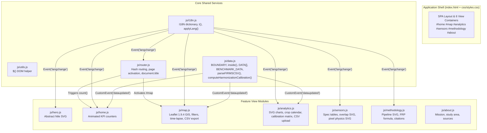
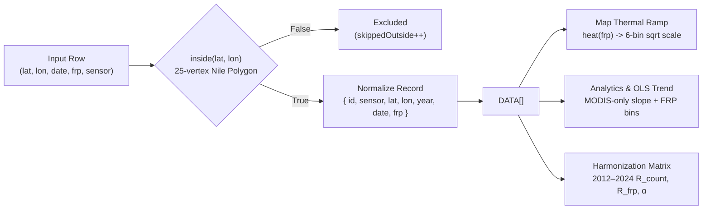

# System Architecture

This document details the software architecture, module boundaries, event-driven state synchronization, and rendering pipelines of **Fire Harmony**.

---

## 1. Architectural Overview

Fire Harmony is a **client-side Single-Page Application (SPA)** built with vanilla HTML5, CSS3, and ES6+ JavaScript. It executes directly in modern web browsers without a build pipeline, bundler, or application server.

### Core Architectural Principles
1. **Zero Build Overhead:** All modules are standard browser scripts loaded sequentially in `index.html`, enabling immediate inspection, modification, and static hosting.
2. **Native SVG Visualization:** Every analytical chart, sensor resolution diagram, and pipeline flowchart is generated via native DOM SVG primitives (`document.createElementNS`), avoiding heavy charting frameworks.
3. **Event-Driven Reactivity:** Independent view modules synchronize via two native browser events—`dataupdated` and `langchange`—eliminating tight coupling between the data store, i18n engine, and UI components.
4. **Deterministic Baseline + Live Ingestion:** A seeded Park-Miller PRNG produces a reproducible benchmark dataset on startup, while an in-browser CSV parser allows users to swap the active dataset with real NASA FIRMS exports at runtime.

---

## 2. High-Level Component Diagram



---

## 3. Script Load Order & Dependency Chain

Because Fire Harmony uses global browser scripts without an ES module bundler, **script execution order in `index.html` is significant**:

| Order | File | Exports / Globals Provided | Depends On |
| :---: | :--- | :--- | :--- |
| 1 | `leaflet.min.js` (CDN) | `L` (Leaflet namespace) | External CDN |
| 2 | `js/utils.js` | `$` (`document.getElementById` shorthand) | DOM |
| 3 | `js/i18n.js` | `I18N`, `LANG`, `t()`, `applyLang()` | `js/utils.js` |
| 4 | `js/data.js` | `NILE_LINE`, `DELTA_LINES`, `BOUNDARY`, `inside()`, `DATA`, `BENCHMARK_DATA`, `computeHarmonizationCalibration()`, `parseFIRMSCSV()`, `loadCustomFIRMS()`, `resetToBenchmark()` | Browser `CustomEvent` |
| 5 | `js/hero.js` | `drawHero()` | `js/utils.js`, `js/i18n.js` |
| 6 | `js/home.js` | `getHomeStats()`, `renderStatsElements()`, `count()` | `js/utils.js`, `js/i18n.js`, `js/data.js` |
| 7 | `js/map.js` | `initMap()`, `render()`, `exportCSV()`, `tlStart()`, `tlStop()` | `L`, `js/utils.js`, `js/i18n.js`, `js/data.js` |
| 8 | `js/analytics.js` | `window.renderAnalytics` (IIFE) | `js/i18n.js`, `js/data.js` |
| 9 | `js/sensors.js` | `window.renderSensors` (IIFE) | `js/i18n.js`, `js/data.js` |
| 10 | `js/methodology.js` | `window.renderMethodology` (IIFE) | `js/i18n.js` |
| 11 | `js/about.js` | Self-initializing IIFE | DOM |
| 12 | `js/router.js` | `route()`, `updateTitle()`, initial `applyLang()` + `route()` bootstrap | All view modules |

> **Important:** `js/router.js` must always remain the **last script** in `index.html` because it reads the saved language from `localStorage` (`fh-lang`), invokes `applyLang(saved)`, and triggers the initial `route()` call after all view listeners are registered.

---

## 4. State Management & Event Bus

Fire Harmony avoids external state containers in favor of two lightweight synchronization channels:

### Active Dataset Store (`DATA` in `js/data.js`)
- `DATA` is a mutable module-level `Array` of fire detection objects (`{ id, sensor, lat, lon, year, date, frp }`).
- `BENCHMARK_DATA` stores an immutable shallow snapshot of the initial procedural dataset so the session can be restored at any time.
- When `loadCustomFIRMS(parsedArray)` or `resetToBenchmark()` mutates `DATA` in place, it dispatches:
  ```js
  document.dispatchEvent(new CustomEvent('dataupdated'));
  ```
- **Current Subscribers:** `js/home.js`, `js/map.js`, `js/analytics.js`.

### Internationalization State (`LANG` in `js/i18n.js`)
- Calling `applyLang('en' | 'ar')`:
  1. Updates `LANG`, `<html lang="...">`, and `<html dir="ltr|rtl">`.
  2. Updates all static `[data-i18n]` text nodes and `[data-i18n-aria]` ARIA labels.
  3. Persists the preference to `localStorage` under the key `fh-lang`.
  4. Dispatches `document.dispatchEvent(new Event('langchange'))`.
- **Current Subscribers:** `js/hero.js`, `js/home.js`, `js/map.js`, `js/analytics.js`, `js/sensors.js`, `js/methodology.js`, `js/router.js`.

---

## 5. Client-Side Routing & View Lifecycle

`js/router.js` implements hash-based routing (`#home`, `#map`, `#analytics`, `#sensors`, `#methodology`, `#about`):

1. Resolves `location.hash` (falling back to `#home` if unknown).
2. Sets `document.body.dataset.page = id`, which also drives per-page CSS background image cropping (`.bgimg` rules in `css/styles.css`).
3. Toggles `.on` on the active `.page` container and updates `aria-current="page"` on `#nav a`.
4. Updates `document.title` with the localized page name.
5. Resets scroll position (`scrollTo(0, 0)`).
6. Runs view-specific activation hooks:
   - `#home`: invokes `count()` to animate KPI counters (bypassed when `prefers-reduced-motion: reduce` is enabled).
   - `#map`: lazily initializes Leaflet via `initMap()` on first visit and calls `map.invalidateSize()` so tile bounds recalculate cleanly after the container becomes visible.

---

## 6. Spatial & Radiometric Processing Flow



---

## 7. External Dependencies & Failure Modes

| External Resource | Source | Failure Handling |
| :--- | :--- | :--- |
| Leaflet 1.9.4 JS/CSS | `cdnjs.cloudflare.com` | `initMap()` checks `typeof L === 'undefined'` and displays localized `t('map_err')` inside `#mapCanvas` |
| CARTO Dark Matter Tiles | `basemaps.cartocdn.com` | Map overlays (`BOUNDARY`, `NILE_LINE`, `DELTA_LINES`, and markers) still render over dark `#0f0a07` canvas if tiles fail |
| Google Fonts | `fonts.googleapis.com` | CSS falls back gracefully to `serif`, `system-ui`, and `sans-serif` |
